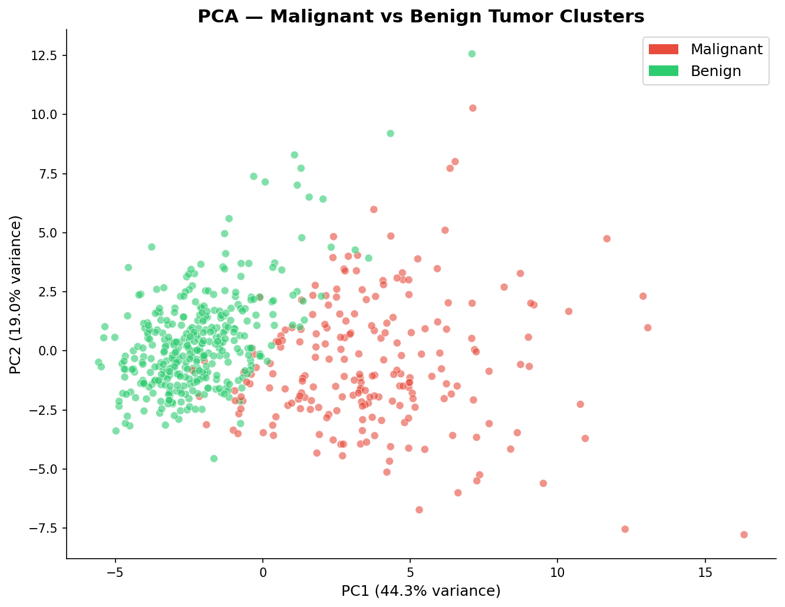
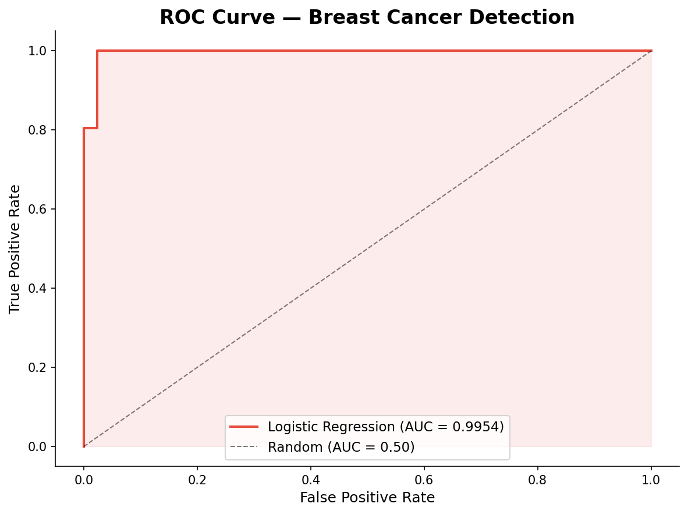
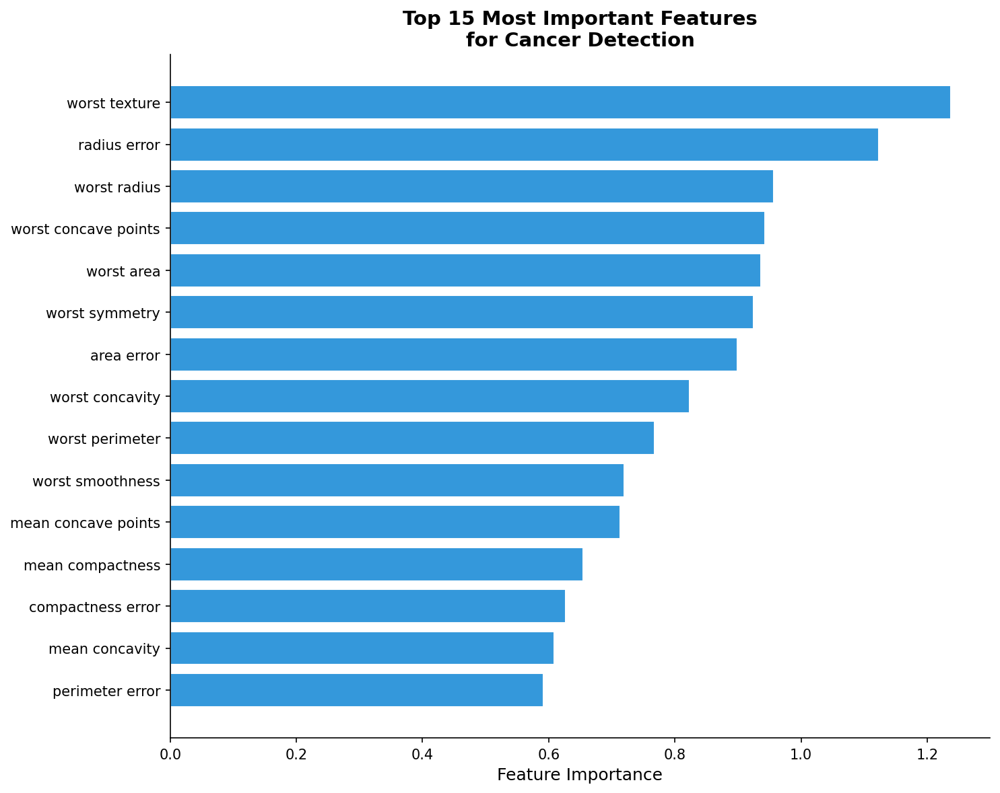
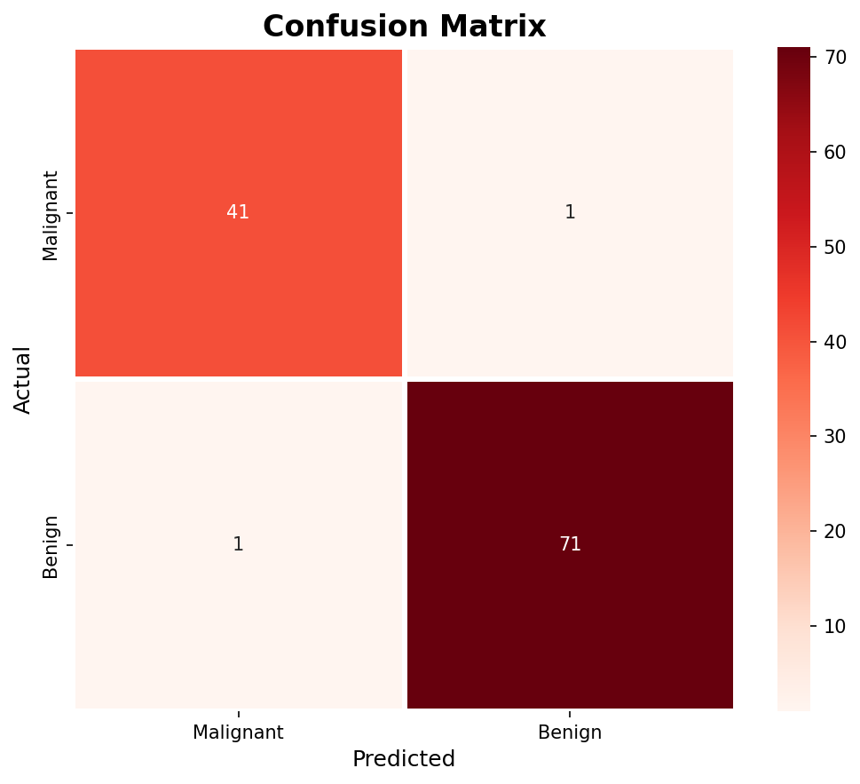
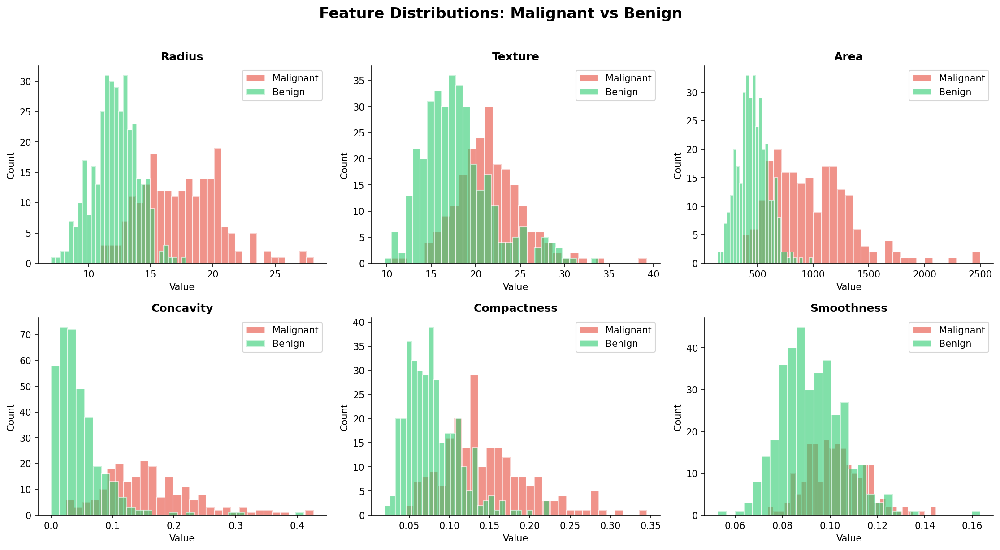

# 🏥 Breast Cancer Detection

**Author:** Rosemary James · ML/Bioinformatics Platform Engineer  
**Stack:** Python · Scikit-learn · FastAPI · Matplotlib · Seaborn  
**Status:** Production-ready  
**ROC-AUC:** 0.9954 | **Accuracy:** 98%

---

## What This Does

Detects breast cancer from cell nuclei measurements - classifying tumors as **Malignant** or **Benign** with 98% accuracy. Trained on the Wisconsin Breast Cancer Dataset, one of the most widely used clinical ML benchmarks.

```
30 Cell Nuclei Measurements
(radius, texture, perimeter, area, smoothness...)
    │
    ▼
StandardScaler normalization
    │
    ▼
Logistic Regression Classifier
    │
    ▼
Malignant / Benign prediction
+ Confidence score
+ Urgency flag
    │
    ▼
REST API Response (FastAPI)
```

---

## Results

| Model | ROC-AUC | CV Score | Accuracy |
|-------|---------|----------|----------|
| **Logistic Regression** | **0.9954** 🏆 | **0.9953** | **98%** |
| Random Forest | 0.9931 | 0.9919 | 97% |
| Gradient Boosting | 0.9897 | 0.9925 | 97% |

---

## Visualisations

### PCA — Malignant vs Benign Clusters


### ROC Curve


### Feature Importance


### Confusion Matrix


### Feature Distributions


---

## Quick Start

### Install dependencies
```bash
pip install scikit-learn fastapi uvicorn matplotlib seaborn numpy pandas
```

### Prepare data + generate plots
```bash
python3 data/prepare_data.py
```

### Train model
```bash
python3 models/train.py
```

### Start API
```bash
python3 api/serve.py
```

### Predict
```bash
python3 -c "
from sklearn.datasets import load_breast_cancer
import json, urllib.request
data   = load_breast_cancer()
sample = data.data[0].tolist()
payload = json.dumps({'features': sample}).encode()
req = urllib.request.Request('http://localhost:8003/predict',
      data=payload, headers={'Content-Type': 'application/json'})
print(json.loads(urllib.request.urlopen(req).read()))
"
```

**Response:**
```json
{
  "prediction": "Malignant",
  "confidence": 1.0,
  "malignant_prob": 1.0,
  "benign_prob": 0.0,
  "urgent": true
}
```

---

## Project Structure

```
cancer-detection/
├── data/
│   ├── prepare_data.py        # Load dataset + generate EDA plots
│   └── cancer_data.csv        # 569 tumor samples
├── models/
│   ├── train.py               # Train + evaluate + generate plots
│   ├── classifier.pkl         # Saved Logistic Regression model
│   ├── scaler.pkl             # Saved StandardScaler
│   ├── feature_names.pkl      # Feature names for API
│   ├── metrics.csv            # Performance metrics
│   └── plots/
│       ├── class_distribution.png
│       ├── correlation_heatmap.png
│       ├── feature_distributions.png
│       ├── roc_curve.png
│       ├── confusion_matrix.png
│       ├── feature_importance.png
│       └── pca_clusters.png
└── api/
    └── serve.py               # FastAPI prediction endpoint (port 8003)
```

---

## The Dataset

The **Wisconsin Breast Cancer Dataset** contains measurements from digitized images of fine needle aspirate (FNA) of breast masses. Features describe characteristics of cell nuclei:

| Feature | Description |
|---------|-------------|
| radius | Mean distance from center to perimeter |
| texture | Standard deviation of grey-scale values |
| perimeter | Perimeter of the cell nucleus |
| area | Area of the cell nucleus |
| smoothness | Local variation in radius lengths |
| compactness | perimeter² / area - 1.0 |
| concavity | Severity of concave portions of contour |
| concave points | Number of concave portions of contour |
| symmetry | Symmetry of the nucleus |
| fractal dimension | Coastline approximation - 1 |

Each feature has 3 values computed: mean, standard error, worst - giving 30 total features.

---

## API Reference

### `GET /`
Health check + model performance summary

### `GET /features`
List all 30 feature names

### `POST /predict`
Classify tumor from measurements

**Request:** `{"features": [30 float values]}`

**Response:**
```json
{
  "prediction": "Malignant",
  "confidence": 1.0,
  "malignant_prob": 1.0,
  "benign_prob": 0.0,
  "urgent": true
}
```

---

## Related Projects

| Phase | Project | Status |
|-------|---------|--------|
| 1 | [Genomics Variant Calling Pipeline](https://github.com/NyamburaaKamau/genomics-variant-pipeline) | ✅ Complete |
| 2 | [DNA Variant Pathogenicity Classifier](https://github.com/NyamburaaKamau/dna-variant-classifier) | ✅ Complete |
| 3 | [scRNA-seq Cell Type Classifier](https://github.com/NyamburaaKamau/scrna-cell-classifier) | ✅ Complete |
| 4 | [Drug Toxicity Predictor](https://github.com/NyamburaaKamau/drug-toxicity-predictor) | ✅ Complete |
| 5 | [Bioinformatics ML Platform](https://github.com/NyamburaaKamau/bioinformatics-platform) | ✅ Complete |
| 6 | **Breast Cancer Detection** (this repo) | ✅ Complete |

---

## Author

**Rosemary James** · ML/Bioinformatics Platform Engineer  
📧 kamaurosemary.n@gmail.com  
🔗 [GitHub](https://github.com/roseemaryy)  